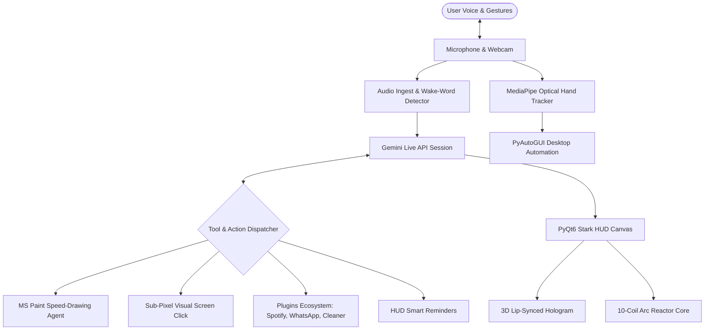

# 🤖 JARVIS (MARK LVI) — Autonomous AI Desktop Agent

<div align="center">


**Next-Generation Multi-modal AI Desktop Voice Assistant & Autonomous Agent by [AFLAHAFI](https://github.com/AFLAHAFI)**  
*Voice • Vision • MediaPipe Hand Gestures • MS Paint Speed-Drawing • Stark Arc Reactor HUD • Sub-Pixel UI Automation*

</div>

---

## 🌟 Overview

**JARVIS (MARK LVI)** is an advanced, fully autonomous personal AI assistant built for desktop operating systems (Windows 10/11, macOS, and Linux). Powered by Google's native bidirectional **Gemini Live API** streaming audio architecture, JARVIS delivers instant voice conversations with zero latency, accompanied by a dynamic Iron-Man-inspired **Stark Arc Reactor & 3D Holographic Lip-Synced Avatar HUD**.

Beyond conversation, MARK LVI acts as an autonomous digital agent capable of perceiving your screen, tracking hand gestures via optical computer vision, physically guiding the mouse to paint artwork live, automating browser tasks, and managing computer operations with zero subscriptions.

---

## 🚀 Key Features

### 1. ⚛️ Dynamic Stark Arc Reactor & 3D Holographic Avatar
* **Smart Hybrid State Machine:**
  * **Speaking / Answering:** Dynamically renders an animated **3D Holographic Head Avatar** with real-time formant and phonetic lip-sync visemes (~50 shapes/second).
  * **Listening / Thinking / Idle:** Seamlessly transitions into a pulsing, sound-reactive **10-Coil Electromagnetic Stark Arc Reactor**.
* **Audio-Reactive Waveforms:** Real-time software rendering with ambient halo glow and cybernetic telemetry HUD.

### 2. 📱 Mini Assistant Floating HUD Mode (Ctrl+M)
* **Compact Multitasking Widget:** Click **▣ MINI** in the header or press **Ctrl+M** to collapse the full HUD into a sleek, frameless, draggable, always-on-top companion widget (320×110 px).
* **Live Status Telemetry:** Reflects current assistant state (● LISTENING in green, ● SPEAKING in cyan, ◈ THINKING in amber).
* **Instant One-Click Restoration:** Click **OPEN HUD ↗** or press **Ctrl+M** anytime to restore the full Stark Arc Reactor HUD to its exact previous window position and geometry.

### 3.. 🖐️ Optical Hand Tracking & Gesture Mouse Control (`actions/hand_mouse.py`)
* Powered by **Google MediaPipe HandLandmarker** (21 3D joint landmarks).
* **Pointer Navigation:** Point your index finger to guide the cursor smoothly across the screen with Exponential Moving Average (EMA) jitter suppression.
* **Pinch-to-Click & Drag:** Pinch your index finger and thumb together (< 0.05 normalized distance) to trigger left-click or drag-and-drop windows and files.
* **Right-Click:** Pinch middle finger and thumb together.
* **Voice Toggle:** Activated instantly via *"Enable hand tracking"* or *"Disable hand tracking"*.

### 7. 🎨 Autonomous MS Paint Live Speed-Drawing (`actions/creative_agent.py`)
* Fully dynamic vector art synthesis for **ANY** subject requested by voice (humans, cats, cars, houses, landscapes, etc.) via Gemini FAST.
* **Physical Mouse Execution:** Opens MS Paint, maximizes it, and physically maneuvers the mouse across the canvas live on screen, rendering continuous bezier-like strokes in real-time.
* **Safe-Bounds Protection:** Ensures drawing is strictly contained inside the canvas sheet without touching toolbars or system controls.

### 4. 🎯 Sub-Pixel Precision Visual Screen Click (`actions/computer_control.py`)
* Multi-layer display capture engine (`mss` + `PIL` + `DirectScreen` fallback) immune to OS display scaling bugs.
* Uses Gemini 2D normalized bounding box localization (`box_2d: [ymin, xmin, ymax, xmax]`) for sub-pixel accuracy.
* Simply say: *"Click on the search bar"*, *"Click the close button"*, or *"Click play button"*.

### 5. ⏰ Smart Audio-Visual HUD Reminders (`actions/reminder.py`)
* Pops up a sleek, cybernetic HUD notification card on screen.
* Plays an acoustic harmonic chime and speaks the reminder aloud via Windows SAPI: *"Sir, reminder: [your message]"*.

### 6. 🔌 Modular Plug-and-Play Plugins Ecosystem (`plugins/`)
* **Spotify & System Media Controller (`plugins/spotify_media.py`):** Control media playback (Play/Pause, Next Track, Previous Track, Mute, Volume Control) via OS multimedia keys.
* **WhatsApp Assistant (`plugins/whatsapp_assistant.py`):** Send messages or open chats directly using WhatsApp Web/App URL protocols.
* **System Deep Cleaner (`plugins/system_cleaner.py`):** Automatically flush Windows `%TEMP%` cache files, empty Recycle Bin silently, and free RAM memory.
* **Extensible:** Drop any `.py` file with a `PLUGIN` dictionary into `plugins/` and JARVIS discovers it automatically on launch!

---

## 🏗️ Architecture



---

## ⚡ Quick Start & Installation

### Step 1: Clone the Repository
```bash
git clone https://github.com/AFLAHAFI/ai-agent_jarvis.git
cd ai-agent_jarvis
```

### Step 2: Automatic One-Click Setup
Run the automated environment setup script:
```bash
python setup.py
```

### Step 3: Configure Your API Key
Copy the template configuration file:
```bash
# On Windows:
copy config\api_keys.json.example config\api_keys.json

# On macOS / Linux:
cp config/api_keys.json.example config/api_keys.json
```
Edit `config/api_keys.json` with your free API key from [Google AI Studio](https://aistudio.google.com/app/apikey):
```json
{
  "gemini_api_key": "YOUR_ACTUAL_GEMINI_API_KEY",
  "os_system": "windows",
  "assistant_name": "JARVIS",
  "user_name": "Sir",
  "ui_color": "#00f0ff",
  "camera_index": 0,
  "hud_style": "hybrid"
}
```

### Step 4: Run JARVIS
On Windows:
```bash
run.bat
```
On macOS / Linux:
```bash
source .venv/bin/activate
python main.py
```

For full platform-specific instructions, see the [📖 Detailed Setup Guide](SETUP_GUIDE.md).

---

## 🗣️ Common Voice Commands

| Action | Example Trigger Voice Phrase |
|---|---|
| **Wake Word** | *"Hey Jarvis"* |
| **Hand Tracking** | *"Enable hand tracking"* / *"Disable hand tracking"* |
| **Visual Click** | *"Click on the search bar"* / *"Click the mute button"* |
| **Live Drawing** | *"Draw a cat in Paint"* / *"Draw a red sports car"* |
| **Media Playback** | *"Play music"* / *"Pause music"* / *"Next track"* / *"Volume up"* |
| **Reminders** | *"Remind me to drink water in 10 minutes"* |
| **System Maintenance** | *"Clean temporary files"* / *"Empty recycle bin"* |
| **WhatsApp** | *"Send a WhatsApp message to [Contact/Number]"* |
| **Gmail** | *"Check my unread emails"* / *"Open Gmail"* / *"Send an email"* |
| **Daily Briefing** | *"Good morning Jarvis"* / *"Give me today's briefing"* / *"What's the news today?"* |
| **Vision Analysis** | *"What's on my screen right now?"* / *"Look at this"* |

---

## 📂 Repository Structure

```
ai-agent_jarvis/
├── actions/                  # Auto-discovered capabilities & tools
│   ├── computer_control.py   # Mouse, keyboard, and visual screen_click
│   ├── creative_agent.py     # Live physical Paint drawing agent
│   ├── hand_mouse.py         # MediaPipe 21-landmark hand tracking mouse
│   ├── reminder.py           # Audio-visual HUD reminder system
│   ├── screen_processor.py   # Display & webcam vision pipeline
│   └── ...                   # YouTube, weather, file controller, web search
├── config/                   # Configuration templates & models
│   ├── api_keys.json.example # Safe configuration template
│   ├── hand_landmarker.task  # MediaPipe hand tracking model
│   └── jarvis.ico            # Stark Industries HUD icon
├── core/                     # Internal subsystems (Gemini Live, audio, UI)
│   ├── avatar.py             # 3D holographic avatar mesh renderer
│   ├── gemini.py             # Resilient multi-tier model ladder
│   ├── plugin_loader.py      # Dynamic plugin discovery engine
│   └── ...
├── memory/                   # Assistant persistent memory
│   └── long_term.json.example# Safe memory schema template
├── plugins/                  # Modular plug-and-play user plugins
│   ├── spotify_media.py      # Multimedia & Spotify controller
│   ├── system_cleaner.py     # Cache, Temp & Recycle Bin cleaner
│   ├── whatsapp_assistant.py # WhatsApp Web automation
│   └── _template.py          # Boilerplate for writing new plugins
├── .gitignore                # Strict security ignore rules
├── LICENSE                   # Open-source MIT License
├── main.py                   # Central daemon & Gemini Live loop
├── ui.py                     # PyQt6 Stark HUD & Arc Reactor engine
├── requirements.txt          # Python dependencies
├── setup.py                  # Automated virtualenv setup script
├── run.bat                   # One-click Windows launcher
├── README.md                 # Project documentation
└── SETUP_GUIDE.md            # Comprehensive setup walkthrough
```

---

## 🔒 Security & Privacy

* **Zero Secret Leakage:** `config/api_keys.json` and `memory/long_term.json` are excluded from version control via `.gitignore`.
* **Safe Local Operations:** All hand tracking and computer vision run 100% locally on your machine via CPU delegates. Audio is only streamed to Gemini Live during active sessions.
* **No Telemetry / No Tracking:** Your personal data, conversation history, and credentials remain solely on your local device.

---

## 🤝 Contributing

Contributions, issues, and feature requests are welcome!
1. Fork the Project: `https://github.com/AFLAHAFI/ai-agent_jarvis`
2. Create your Feature Branch: `git checkout -b feature/NewPlugin`
3. Commit your Changes: `git commit -m 'Add awesome new plugin'`
4. Push to the Branch: `git push origin feature/NewPlugin`
5. Open a Pull Request

---

## 📜 License

Distributed under the **MIT License**. See [`LICENSE`](LICENSE) for more details.

---

<div align="center">
Developed with ❤️ by <a href="https://github.com/AFLAHAFI">AFLAHAFI</a>
</div>
